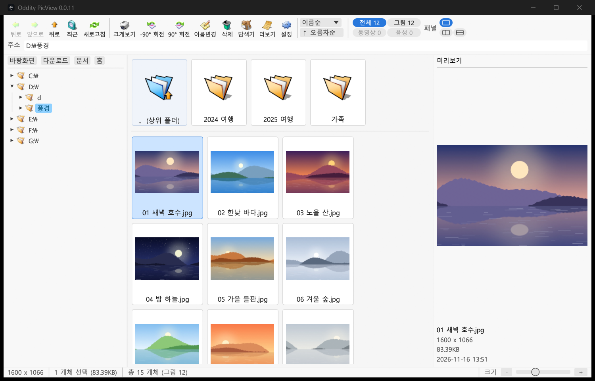

# oddity-picview

알씨처럼 쓰는 윈도우용 그림 뷰어이다. Rust와 egui로 만들었다. 실행 파일 하나(약 10MB)만 있으면 된다.

- **빠르다.** 사진 100장 폴더의 썸네일을 알씨보다 4.1배 빨리(1.56초 → 0.38초) 그리고, 다시 열 때는 5.2배 빨리(1.76초 → 0.34초) 그린다. 메모리는 알씨의 절반쯤(315MB → 141MB)만 쓴다. [아래 비교표](#알씨와-속도-비교)
- **완전히 무료다.** 값을 받지 않고, 광고가 없고, 회원 가입과 로그인도 없다. 프로그램이 스스로 인터넷에 접속하지 않고, 사용 기록을 어디에도 보내지 않는다 (About 창의 GitHub 주소를 누를 때만 브라우저가 열린다). 설치 없이 exe 하나로 돈다.
- **소스가 공개돼 있다.** MIT 라이선스라 개인, 회사 모두 무료로 쓰고 고치고 다시 나눠 줄 수 있다.



(화면의 그림 12장은 README 용으로 프로그램으로 그린 예시다.)

버전마다 바뀐 것은 [CHANGELOG.md](CHANGELOG.md) 에 있다.

## 화면

- 왼쪽: 드라이브 폴더 트리, 바로가기(바탕화면, 다운로드, 문서, 홈), 즐겨찾기. 트리는 폴더만 보여 주며, 펼친 폴더 안에 폴더가 없으면 "(하위 폴더 없음)"이라고 뜬다.
- 가운데: 썸네일 목록 (맨 앞의 ".. (상위 폴더)" 칸은 파란 폴더와 회청색 바탕으로 다른 폴더와 구별한다. 폴더 먼저, 이름은 자연 정렬: 2 → 10 순). 크기는 Ctrl+휠, 또는 아래 상태 줄 오른쪽의 슬라이더나 -/+ 버튼으로 바꾼다 (16픽셀씩, 64 → 256픽셀). 썸네일이 96픽셀보다 크면 폴더는 96픽셀 작은 칸으로 맨 위에 따로 모이고, 가는 선 아래에서 그림이 새 줄로 시작한다.
- 위: 툴바, 정렬(기준 / 방향), 종류 필터(전체 그림 / 동영상 음성), 주소 줄
- 오른쪽: 고른 파일 미리보기와 크기, 용량, 수정 시각. 동영상은 10장을 돌려 보여 주고, 음성은 재생 단추와 재생 막대가 나온다.
- 아래: 그림 해상도, 고른 개수와 용량, 전체 개수, 썸네일 크기 막대

## 빠르게 만든 방법

- 썸네일은 CPU 코어 수만큼 스레드를 띄워 나눠 만든다.
- JPEG 썸네일은 디코딩 단계에서 1/8까지 줄여 읽는다. 4000x3000 사진이면 전체를 풀지 않고 500x375만 푼다.
- 화면에 보이는 칸과 그 아래 두 줄만 썸네일을 만든다. 빠르게 스크롤해서 지나간 칸은 만들지 않고 건너뛴다.
- 썸네일은 메모리에 최대 800장까지만 두고, 화면에서 먼 것부터 버린다.
- 크게보기에서는 앞뒤 그림을 미리 읽어 두어서 넘길 때 기다리지 않는다. 최근 8장은 메모리에 남겨 둔다.
- 사진의 EXIF 회전 정보를 읽어서 바로 세워 보여 준다.
- 만든 썸네일은 디스크에 저장해 두고, 다음에 같은 폴더를 열면 저장한 것을 읽는다. 다운로드 폴더(그림 127장)에서 새로 만들면 0.20초, 저장한 것을 읽으면 0.02초가 걸렸다.

## 알씨와 속도 비교

사진 100장 폴더를 열고 썸네일이 다 그려질 때까지 (5번 잰 중앙값)

| | 알씨 10.2.0.3 | oddity-picview | 차이 |
|---|---|---|---|
| 처음 여는 폴더 (썸네일 캐시 없음) | 1.56초 | 0.38초 | 4.1배 빠름 |
| 다시 여는 폴더 (썸네일 캐시 있음) | 1.76초 | 0.34초 | 5.2배 빠름 |
| CPU 사용 시간, 처음 | 4.41초 | 1.52초 | 2.9배 적음 |
| CPU 사용 시간, 다시 | 2.61초 | 0.59초 | 4.4배 적음 |
| 최대 메모리, 처음 | 239MB | 178MB | |
| 최대 메모리, 다시 | 315MB | 141MB | |

측정 조건과 방법: [bench/README.md](bench/README.md)

## 썸네일 저장

- 위치: `%LOCALAPPDATA%\oddity-picview\thumbs`
- 불투명한 그림은 JPEG(품질 88)로, 투명한 부분이 있는 그림은 PNG로 저장한다. 127장에 1.9MB가 들었다.
- 파일 경로, 크기, 수정 시각으로 이름을 정한다. 원본을 고치면 새 썸네일을 만든다.
- 최대 크기(처음 값 100MB)를 넘으면 프로그램을 켤 때 오래 안 본 것부터 지워 최대 크기의 80%로 줄인다. 최대 크기는 툴바의 "설정"에서 100MB → 1GB 사이로, 슬라이더를 끌거나 숫자를 직접 넣어 바꾼다.
- "설정" 창에서 지금 쓰는 양을 보고, 바로 줄이거나 모두 비우거나 캐시 폴더를 열 수 있다.

속도 측정은 아래처럼 한다.

```
PICVIEW_BENCH_DIR=C:\Users\me\Pictures cargo test --release bench -- --ignored --nocapture
```

## 회전 저장

툴바의 회전 버튼, 오른쪽 버튼 메뉴, 크게보기의 R / L 키로 돌리면 화면에서 바로 돌고, 파일에도 바로 저장한다.

- JPEG: 그림 데이터는 그대로 두고 EXIF의 방향 값만 바꾼다. 다시 압축하지 않으므로 화질이 떨어지지 않고, 파일 크기도 거의 그대로다.
- PNG, BMP, TIFF, WebP: 그림을 돌려 같은 형식으로 다시 저장한다. 모두 무손실이다.
- GIF, ICO: 파일에 저장하지 않고 화면에서만 돌린다.

## 오른쪽 버튼 메뉴

썸네일, 목록의 빈 곳, 폴더 트리, 즐겨찾기에서 오른쪽 버튼을 누르면 탐색기의 오른쪽 메뉴를 그대로 띄운다(윈도우 셸 메뉴, IContextMenu). 알씨, PowerRename, 연결 프로그램 ▶, 보내기 ▶ 처럼 다른 프로그램이 넣은 항목도 탐색기와 같이 나온다. 빈 곳에서 띄우면 탐색기 빈 곳 메뉴(새로 만들기 ▶, 속성 등)가 된다.

- 맨 위에는 픽뷰 항목을 덧붙인다. 파일 위: 크게보기, 복사할 곳 ▶, 이동할 곳 ▶. 빈 곳과 트리: 즐겨찾기에 추가(제거), 새로고침.
- 메뉴의 이름 바꾸기, 삭제, 잘라내기, 복사, 붙여넣기는 픽뷰 기능으로 돌린다. 그래서 설정의 "지우기 전에 물어보기"와 잘라낸 파일을 흐리게 그리는 표시가 그대로 먹는다.
- 윈도우 11의 스토어 앱 항목(사진으로 편집, 그림판으로 편집, Clipchamp로 편집, Copilot에게 질문하기)은 늦게 불러와져서, 프로그램을 켜고 처음 띄운 메뉴에는 빠질 때가 있다. 다시 띄우면 나온다.
- 크게보기 화면에서도 오른쪽 버튼으로 같은 메뉴를 띄운다. 맨 위에 "전체 화면으로 보기"(전체 화면일 때는 "창으로 보기"), "목록으로 돌아가기"가 붙는다. 압축 파일 안 그림은 전체 화면, 경로 복사, 목록으로 돌아가기만 있는 간단한 메뉴가 뜬다.
- 셸 메뉴를 띄우지 못하면 아래 표의 픽뷰 메뉴를 대신 띄운다.

| 메뉴 | 단축키 | 하는 일 |
|---|---|---|
| 폴더 생성 | Ctrl+N | 이름을 물은 뒤 새 폴더를 만든다 |
| 즐겨찾기에 추가 | | 폴더를 왼쪽 즐겨찾기에 넣는다 |
| 잘라내기 / 복사 | Ctrl+X / Ctrl+C | 윈도우 클립보드에 파일을 올린다. 탐색기에 붙여넣어도 된다 |
| 붙여넣기 | Ctrl+V | 탐색기의 복사 창을 띄워 붙여넣는다. 같은 이름이 있으면 탐색기처럼 묻는다 |
| 삭제 | Del | 휴지통으로 보낸다 |
| 이름 변경 | F2 | |
| 파일 속성 | | 윈도우 속성 창을 띄운다 |
| 새로고침 | F5 | |

## 끌어서 복사, 옮기기

- 썸네일을 골라 왼쪽 폴더 트리, 즐겨찾기, 목록 안의 폴더로 끌어다 놓으면 복사하거나 옮긴다.
- 왼쪽 폴더 트리의 폴더도 끌 수 있다. 다른 트리 폴더, 목록의 폴더, 다른 패널, 창 밖(탐색기 등)에 놓는다. 드라이브(C:\ 등)는 끌 수 없다. 열어 둔 폴더를 옮기면 그 패널은 남아 있는 가장 가까운 위 폴더로 간다.
- 탐색기와 같은 규칙이다. 같은 드라이브면 옮기고, 다른 드라이브면 복사한다. Ctrl을 누르면 복사, Shift를 누르면 옮긴다.
- 끄는 동안 마우스 옆에 "3개 → 사진 (이동)" 처럼 무엇을 어디로 보내는지 뜬다. 놓을 수 있는 폴더는 파란 테두리가 생긴다.
- 끈 채로 창 밖으로 나가면 윈도우의 끌어놓기로 넘어간다. 브라우저, 탐색기, 바탕화면, 메신저에 놓을 수 있다. 원본이 지워지지 않도록 복사(또는 바로가기)만 한다.
- 오른쪽 버튼 메뉴의 "복사할 곳", "이동할 곳"에는 최근에 파일을 보낸 폴더 10개가 나온다. "폴더 선택…"으로 다른 폴더를 고를 수도 있다. 이 목록은 껐다 켜도 남는다.

## 종류별로 보기

- 툴바 오른쪽의 "전체 · 그림 · 동영상 · 음성" 단추로 한 종류만 볼 수 있다. 단추마다 그 폴더에 있는 개수가 붙는다.
- 폴더는 어느 것을 골라도 보인다. 다른 폴더로 옮겨도 고른 종류가 그대로 간다.
- 한 종류만 보는 동안에는 아래 상태 줄에 "동영상만 보는 중 (가린 파일 4개)" 처럼 뜬다.
- 껐다 켜면 다시 "전체"로 시작한다.

## 자동 새로고침

- 열려 있는 패널의 폴더(최대 2개)를 윈도우 변경 알림(`notify` 크레이트, ReadDirectoryChangesW)으로 지켜본다. 브라우저 내려받기, 탐색기, 카메라 가져오기처럼 다른 프로그램이 폴더를 바꾸면 F5 없이 목록이 바뀐다.
- 알림이 그치고 0.3초 조용하면 다시 읽는다. 계속 바뀌는 중이라도 1.5초에 한 번은 반영한다. 사진 4장을 넣고 1.2초 뒤에 보니 목록이 1 → 5개로 바뀌어 있었다.
- 다시 읽어도 고른 파일, 스크롤 위치, 썸네일은 그대로다. 크기나 수정 시각이 바뀐 파일만 썸네일을 새로 만든다.
- 이름 바꾸기 같은 창이 떠 있거나 끌기 중이면 끝난 뒤에 다시 읽는다. 크게보기로 보던 파일이 사라지면 목록으로 돌아간다. 열어 둔 폴더가 사라지면 남은 가장 가까운 위 폴더로 간다.
- 네트워크 드라이브는 알림이 오지 않을 수 있다. 그때는 F5로 새로 읽는다.

## 여러 패널로 보기

- 종류 필터 오른쪽의 "패널" 단추 3개로 목록을 1개 또는 2개 패널로 본다. 단추에는 네모 그림이 있다: 빈 네모(하나, 윗줄), 세로줄 네모(좌우), 가로줄 네모(상하, 둘은 아랫줄). 마우스를 올리면 이름이 뜬다.
- 패널이 2개일 때는 높이 24픽셀 머리줄에 폴더 이름, 뒤로(◀), 위로(▲) 단추가 나온다. 고른 패널은 파란 2픽셀 테두리, 나머지는 회색 1픽셀 테두리다. 패널이 1개면 머리줄과 테두리가 없다.
- 패널 안에서 왼쪽 클릭, 오른쪽 클릭, 끌기 시작을 하면 그 패널이 골라진다. 휠로 스크롤만 하면 바뀌지 않는다. Tab은 다음 패널, Shift+Tab은 앞 패널을 고른다. 주소 줄에 글을 쓰는 중에는 Tab으로 패널을 바꾸지 않는다.
- 툴바, 주소 줄, 키보드, 왼쪽 트리, 오른쪽 미리보기는 고른 패널을 따른다. 패널을 바꾸면 음성 미리듣기가 멎는다. 썸네일 크기, 정렬, 종류 필터는 모든 패널에 같이 적용한다. 메모리의 썸네일은 모든 패널을 합해 최대 800장이다.
- 다른 패널의 빈 곳, 파일 칸, 머리줄에 끌어 놓으면 그 패널의 폴더로 보낸다. 폴더 칸에 놓으면 그 하위 폴더로, ".." 칸에 놓으면 위 폴더로 보낸다. 자기 폴더의 빈 곳에 놓으면 옮기지 않는다. 같은 드라이브는 이동, 다른 드라이브는 복사하며 Ctrl은 복사, Shift는 이동이다.
- 1개에서 2개로 나누면 새 패널은 고른 패널과 같은 폴더를 연다. 좌우와 상하를 바꿔도 폴더, 선택, 스크롤은 그대로다. [하나]를 누르면 2번 패널을 닫고, 고른 패널이 닫히면 1번 패널을 고른다. 닫힌 패널의 크게보기도 닫는다.
- 패널 나누기(하나, 좌우, 상하), 패널마다 폴더, 고른 패널 번호를 기억한다. 실행할 때 경로를 넘기면 고른 패널만 그 경로로 연다. 없어진 폴더는 남아 있는 가장 가까운 위 폴더로 바꾸고, 위 폴더도 없으면 고른 패널의 폴더로 바꾼다.

## 전체 화면

- 목록에서 그림을 고르고 툴바의 "전체 화면" 단추나 F11을 누르면 바로 전체 화면으로 본다. 크게보기에서는 F, F11, 또는 오른쪽 위 ⛶ 단추로 켜고 끈다.
- 전체 화면은 바탕이 검다. 마우스를 2초 움직이지 않으면 커서를 숨긴다.
- 오른쪽 위 ⛶ 단추는 마우스를 움직이면 나타나고, 1.5초 가만히 있으면 0.3초 동안 흐려지며 사라진다.
- Esc를 누르면 전체 화면을 풀고 목록으로 돌아간다.
- 크게보기에서 오른쪽 버튼 메뉴의 "전체 화면으로 보기" / "창으로 보기"로도 바꾼다.

## 압축 파일 (만화책)

- zip, cbz, rar, cbr, 7z, cb7 파일이 목록에 나온다. 썸네일은 안에 든 첫 그림(표지)이고, 왼쪽 아래에 ZIP / RAR / 7Z 표시가 붙는다.
- 더블 클릭하거나 Enter를 누르면 폴더처럼 들어가 안의 그림을 썸네일로 본다. 순서는 자연 정렬이라 2쪽이 10쪽 앞에 온다. 안에 폴더가 있어도 그림을 모두 한 목록으로 보여 준다.
- 크게보기에서 휠, ←/→, Space로 쪽을 넘긴다. ".." 칸이나 위로(Backspace)를 누르면 압축 파일이 있던 폴더로 돌아간다.
- 압축 안은 읽기 전용이다. 회전 저장, 이름 바꾸기, 삭제, 옮기기, 붙여넣기는 할 수 없다. 압축 파일 자체는 다른 파일처럼 옮기고 지울 수 있다.
- 압축 안을 보다가 끄면 다음에 켤 때 그 압축 안으로 다시 들어간다. 압축 파일이 바뀌거나 지워지면 자동 새로고침이 반영한다.
- 암호가 걸렸거나 깨진 압축 파일은 "그림 없음"으로 보인다. 프로그램이 멈추지 않는다.
- 종류 필터에서는 "그림"으로 센다.

## 동영상, 음성 파일

- 동영상(mp4, mkv, avi, mov, wmv, webm 등 13가지)과 음성(mp3, wav, flac, m4a 등 8가지)도 목록에 보인다.
- 썸네일은 윈도우 탐색기가 쓰는 것을 그대로 받아 온다. 동영상은 장면 한 컷, 음성은 앨범 그림이나 기본 플레이어 아이콘이 나온다.
- 썸네일 왼쪽 아래에 동영상은 ▶, 음성은 ♪ 표시가 붙는다.
- 동영상 미리보기: 영상 길이의 5%, 15%, … 95% 자리에서 10장을 뽑아 한 장에 0.7초씩 돌려 보여 준다. 오른쪽 미리보기 칸에서는 동영상을 고르면 돌고, 목록에서는 썸네일에 마우스를 0.3초 올려 두면 그 칸만 돈다. 아래의 막대 10개 중 밝은 것이 지금 장면이다. "설정"의 "동영상 미리보기"에서 끌 수 있다(처음 값은 켬). 끄면 썸네일 한 장만 보인다.
  - 윈도우에 든 디코더(Media Foundation)로 뽑으므로 프로그램 크기가 늘지 않는다. mp4, mov, wmv, avi를 읽고, mkv와 webm은 윈도우에 코덱 확장이 있어야 한다. 못 읽으면 썸네일 한 장만 보인다.
  - 1080p 2분짜리 영상에서 10장을 뽑는 데 약 4초 걸렸다. 뽑은 10장은 한 장의 그림(약 180KB)으로 썸네일 캐시에 저장해 두고, 다음부터는 바로 띄운다.
- 더블 클릭하거나 Enter를 누르면 윈도우 기본 프로그램으로 연다.
- 음성 파일은 고른 뒤 Space를 누르면 그 자리에서 미리 듣는다. 오른쪽 미리보기 칸에 재생 단추, 시간, 재생 막대가 나오고, 막대를 누르거나 끌면 그 위치로 건너뛴다. 다른 파일로 옮기면 멎는다.
- 미리듣기는 mp3, wav, flac, ogg, m4a, aac를 읽는다. wma와 opus는 기본 프로그램으로 열어야 한다.

## 내려받기

[Releases](https://github.com/destory1984/oddity-picview/releases) 에서 `oddity-picview.exe` 를 받아 실행한다. 설치는 없다.

- 처음 실행할 때 "Windows의 PC 보호" 창이 뜨면 **추가 정보 → 실행**을 누른다. 코드 서명을 하지 않은 프로그램이라 인터넷에서 받은 exe에 윈도우가 띄우는 경고다. 직접 빌드한 exe에는 뜨지 않는다.
- HEIC, RAW를 보려면 Microsoft Store에서 "HEIF 이미지 확장", "Raw 이미지 확장"을 설치한다.
- Windows 보안의 "제어된 폴더 액세스"(랜섬웨어 방지)가 켜져 있으면, 사진·문서·바탕 화면 폴더에서 회전 저장, 이름 바꾸기, 옮기기, 삭제가 "허용되지 않은 변경이 차단됨" 알림과 함께 막힌다. 해결 방법 4가지와 장단점은 [docs/controlled-folder-access.md](docs/controlled-folder-access.md) 에 있다.

경고 창 없이 받으려면, 명령 프롬프트나 PowerShell에서 curl로 받는다. curl은 윈도우 10, 11에 기본으로 들어 있다.

```
curl -LO https://github.com/destory1984/oddity-picview/releases/latest/download/oddity-picview.exe
```

브라우저는 받은 파일에 "인터넷에서 받음" 표시를 붙이고, 윈도우는 이 표시가 있는 서명 없는 exe에 경고를 띄운다. curl은 이 표시를 붙이지 않는다. 경고만 안 뜰 뿐 파일은 같다.

## 빌드

```
cargo build --release
```

결과물은 `target/release/oddity-picview.exe` (9.9MB)에 생긴다. 음성 미리듣기의 rodio로 7.4MB → 9.1MB, 자동 새로고침의 notify로 9.3MB, 압축 파일 크레이트로 9.9MB가 됐다. 실행할 때 폴더나 파일 경로를 넘기면 그 위치에서 연다. 파일을 넘기면 바로 크게보기로 연다.

## 기억하는 것

프로그램을 끌 때(그리고 켜 둔 동안 30초마다) 아래를 `%APPDATA%\oddity-picview\data\app.ron` 에 저장하고, 다음에 켤 때 되살린다.

- 마지막으로 본 폴더 (실행할 때 경로를 넘기면 그 경로가 먼저다)
- 패널 나누기(하나, 좌우, 상하), 패널마다 연 폴더(최대 2개), 고른 패널 번호
- 정렬 방법, 오름차순/내림차순, 썸네일 크기
- 설정 창의 값: 썸네일 캐시 최대 크기, 지우기 전에 물을지, 동영상 미리보기 켜기/끄기
- 즐겨찾기
- 최근에 파일을 보낸 폴더 10개
- 최근에 연 폴더 10개 (툴바의 "최근 ▼" 에서 고른다. 지워진 폴더는 빠진다)
- 창 크기와 위치, 왼쪽/오른쪽 칸 너비, 폴더 트리 펼침 상태

## 단축키

목록에서:

| 키 | 동작 |
|---|---|
| 방향키, PageUp/Down, Home/End | 이동 (Shift를 누르면 범위 선택) |
| Tab / Shift+Tab | 다음 패널 / 앞 패널 고르기 (글 입력 중에는 적용하지 않는다) |
| Ctrl+클릭, Ctrl+A | 여러 개 선택, 모두 선택 |
| Enter, 더블 클릭 | 폴더 열기 / 크게보기 |
| F11 | 고른 그림을 전체 화면으로 보기 (툴바의 "전체 화면" 단추와 같다) |
| Space | 음성 파일 미리듣기 / 일시정지 |
| Ctrl+휠 | 썸네일 크게 / 작게 |
| Ctrl+1 / 2 / 3 / 4 | 전체 / 그림 / 동영상 / 음성만 보기 |
| Backspace, Alt+↑ | 위 폴더 |
| Alt+←/→, 마우스 뒤로/앞으로 버튼 | 뒤로 / 앞으로 |
| Delete | 휴지통으로 보내기 (확인 창이 뜬다) |
| F2 | 이름 바꾸기 |
| F5 | 새로고침 |
| Ctrl+N | 폴더 생성 |
| Ctrl+X / Ctrl+C / Ctrl+V | 잘라내기 / 복사 / 붙여넣기 |

크게보기에서:

| 키 | 동작 |
|---|---|
| 휠, ←/→, Space, PageUp/Down | 이전 / 다음 그림 |
| Ctrl+휠, +/- | 확대 / 축소 (마우스 위치 기준) |
| 끌기 | 그림 옮기기 |
| 0 | 창에 맞추기 |
| 1 | 원본 크기 |
| R / Shift+R (또는 L) | 90도 / -90도 돌리고 파일에 저장 |
| F, F11 | 전체 화면 켜기 / 끄기 (오른쪽 위 ⛶ 단추와 같다) |
| Esc, Enter, 더블 클릭 | 목록으로 돌아가기 |

## 읽는 형식

| 형식 | 읽는 방법 |
|---|---|
| jpg, jpeg, jfif, png, bmp, webp, tif, tiff, ico | 프로그램에 든 디코더 |
| gif | 움직이는 GIF는 크게보기와 미리보기에서 재생한다. 썸네일은 첫 장면이다. 프레임은 메모리에 최대 512MB까지 올리고, 넘으면 첫 장면만 보여 준다 |
| heic, heif, avif | 윈도우 이미지 코덱(WIC). Microsoft Store의 "HEIF 이미지 확장"이 필요하다 |
| dng, cr2, cr3, nef, arw, orf, rw2, raf 등 카메라 RAW 23가지 | 윈도우 이미지 코덱(WIC). Microsoft Store의 "Raw 이미지 확장"이 필요하다 |

- HEIC와 RAW의 썸네일은 윈도우 탐색기의 썸네일을 받아 온다. RAW는 파일 안에 든 미리보기 그림을 쓰므로 빠르다.
- 아이폰 HEIC 3장(3024x4032)을 1024픽셀로 줄여 읽어 보니, 방향이 탐색기 썸네일과 같게 나왔다.
- 확장이 없으면 "이 형식을 읽을 코덱이 없습니다"라고 알려 준다.
- HEIC, RAW, GIF, ICO는 회전을 파일에 저장하지 않고 화면에서만 돌린다.

## 라이선스

MIT. [LICENSE](LICENSE) 파일을 본다.

툴바와 폴더 아이콘은 Haiku OS 아이콘(Copyright (c) 2007-2026 Haiku, Inc., MIT)이다. 쓴 아이콘 목록과 라이선스 원문은 [assets/icons](assets/icons) 에 있다.

rar, cbr 풀기는 `unrar` 크레이트(MIT / Apache 2.0)가 빌드하는 RARLAB의 UnRAR 소스를 쓴다. UnRAR 라이선스는 무료로 쓰고 나눠 줄 수 있지만, RAR 압축기를 만드는 데 쓰는 것을 금지한다. 픽뷰는 풀기만 한다. UnRAR 소스는 이 저장소에 들어 있지 않고, 빌드할 때 크레이트와 함께 내려받는다.

## 아직 없는 것

- RAW 파일로는 아직 직접 시험하지 못했다. HEIC와 같은 윈도우 이미지 코덱 경로를 쓴다
- rar, cbr은 이 PC에 rar를 만드는 프로그램이 없어 실제 파일로 시험하지 못했다. zip, cbz는 12쪽짜리 만화 파일로, 7z는 자동 시험으로 확인했다
